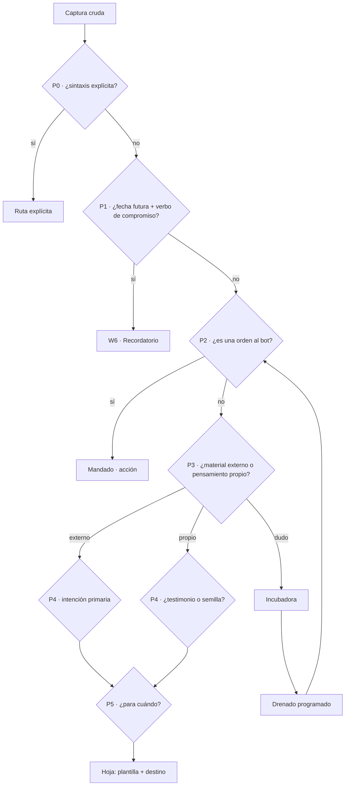
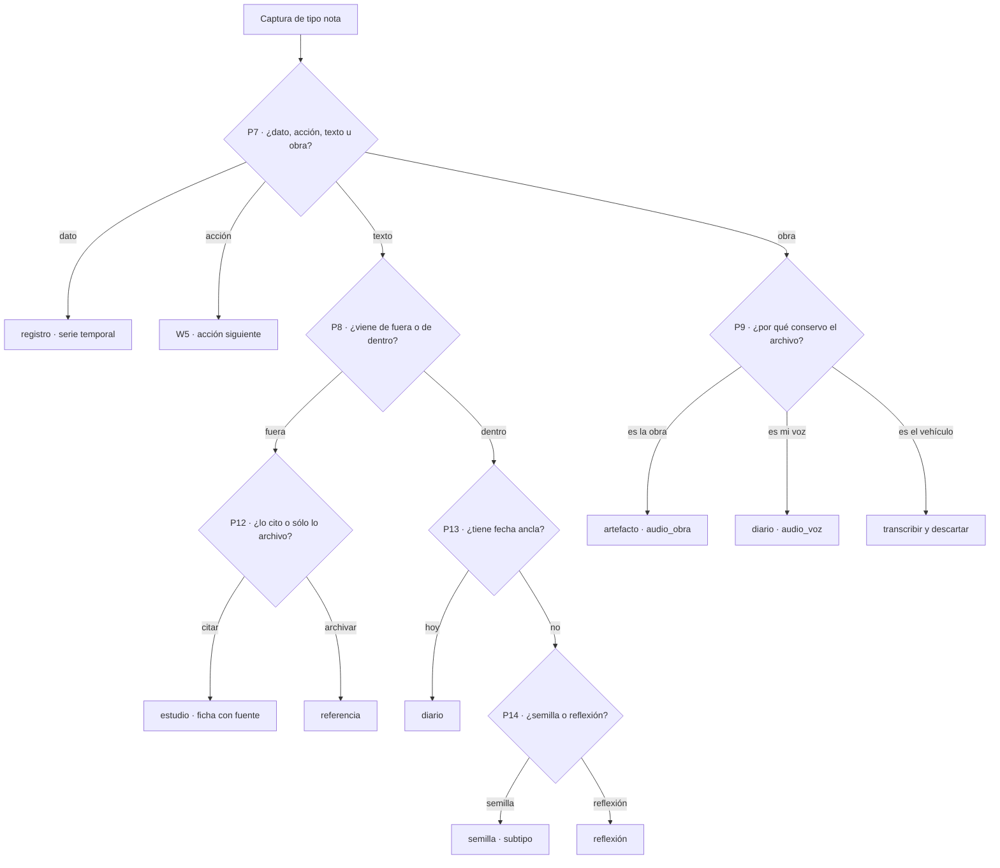
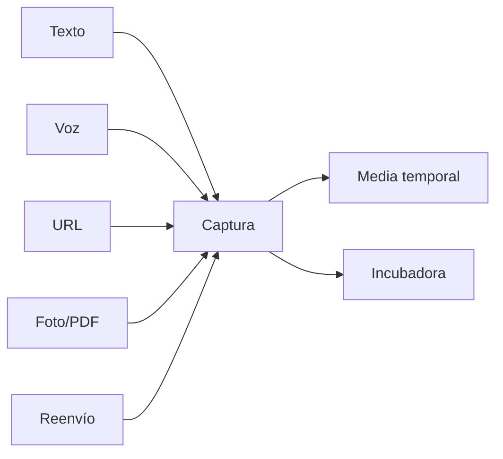

# 🔀 FLUJOS — Intención, puertas de decisión y recuperación

> Documento vivo. Punto y aparte respecto a [BOT.md](BOT.md) (`A.*` = arquitectura, `B.*` = features), pero sigue el mismo proyecto. Aquí se diseñan **flujos de trabajo y árboles de decisión**, no funciones de Modal. Prefijo **`W`** para flujos; **`P`** para puertas de decisión. Actualizado: 2026-10-27.

---

## 0. Para quién se diseña

El sistema no se diseña para "un usuario", se diseña para un perfil concreto con vicios concretos. Esto cambia las prioridades:

- **Creativa con muchos puentes lógicos:** genera conexiones entre cosas que no se parecen, y quiere ver *por qué* se tomó cada decisión.
- **Documenta mucho su vida:** el volumen no es el problema; el problema es el volumen *sin salida*.
- **Necesita recuperación por encima de captura:** guardar ya es fácil. Encontrar y *volver* es el cuello de botella real.
- **Uso formal e informal:** universidad y vida personal en el mismo canal, con exigencias distintas.
- **Universitaria:** ciclos, materias, lecturas, exámenes, citas.
- **Optimizadora:** si el sistema no muestra su propio coste, se convierte en el proyecto.
- **Procrastinadora:** las listas largas la bloquean; necesita una sola cosa siguiente.
- **Todo desordenado:** el desorden se resuelve con destinos claros, no con disciplina.

### Traducción a requisitos

| # | Requisito | Consecuencia de diseño |
|---|---|---|
| R1 | Capturar sin decidir | La captura **nunca** pregunta nada. Cero fricción en el momento. |
| R2 | Clasificar es un paso aparte y diferible | La bandeja de entrada (`incubadora`) es un estado normal, no una deuda vergonzosa. |
| R3 | Nada se descarta en silencio | Toda duda tiene destino. No hay borrado implícito. |
| R4 | Recuperar sin recordar dónde lo puse | La recuperación no depende de rutas ni nombres: depende de **intención** y **contexto**. |
| R5 | Arrancar, no planificar | Cada ítem accionable produce **una** acción siguiente concreta. |
| R6 | Tolerar ambigüedad sin perder recuperabilidad | Clasificación incompleta = válida. Clasificación *incorrecta y silenciosa* = fallo. |
| R7 | El sistema no puede volverse el proyecto | Tope de meta-trabajo (ver §8). |
| R8 | Formal e informal a la vez | Un eje `registro` que cambia plantilla y rigor, no el canal. |
| R9 | Decisiones auditables | Cada captura guarda la **traza** de puertas que la enrutaron. |
| R10 | Anti-bloqueo | Límite de trabajo activo en curso y oferta de **una sola** tarea. |

---

## 1. Principio rector

> **Capturar es barato y sin juicio. Decidir es explícito y diferible. Recuperar es el producto.**

Los tres errores típicos de un archivista de vida, y cómo se evitan aquí:

1. **Capturar y clasificar a la vez** → el usuario deja de capturar porque cada captura cuesta una decisión. *Se evita con la incubadora.*
2. **Clasificar con una sola etiqueta** → el sistema archiva por "tipo de archivo" (nota, audio, video) y no por "para qué lo quiero". *Se evita con el eje de intención.*
3. **Optimizar el sistema en lugar de usarlo** → el archivo crece, la salida no. *Se evita con el tope de meta-trabajo.*

---

## 2. Modelo de tres ejes

`B.2` clasifica con un solo eje (`recordatorio | mandado | nota | otro`). Ese eje decide **qué hace el bot**, pero no sirve para **recuperar**. Para recuperar hacen falta tres ejes más un registro.

### Eje 0 — Registro (con qué formalidad)

| Valor | Cuándo | Efecto |
|---|---|---|
| `formal` | materia, PDF, paper, cita, apunte de clase, trámite | Plantilla estricta: título obligatorio, `curso`, autoría, cita, lugar de la fuente. Rigor alto. |
| `informal` | voz espontánea, idea suelta, momento, reenvío personal | Plantilla mínima: sin título obligatorio, sin resumen forzado. Rigor bajo. |

Regla dura: **el modo informal está permitido quedar sin clasificar.** Si el sistema exige rigor a las tres de la mañana, la persona deja de capturar y eso rompe todo lo demás.

### Eje 1 — Naturaleza (qué es)

`texto` · `audio` · `imagen` · `documento` · `video` · `enlace`

Ya cubierto por `B.2` (audios), `B.3` (OCR), `B.7`/`B.8` (enlaces). Este eje decide **procesamiento** (ASR, OCR, extracción), no destino.

### Eje 2 — Intención (qué quiero hacer con esto) ← el eje nuevo

| Intención | Significado | Horizonte típico | Destino |
|---|---|---|---|
| `archivar` | quiero poder volver a esto algún día | `algún_día` | nota fría + índice |
| `entender` | esto entra en algo que estoy estudiando | `semestre` | ficha de estudio (`W3`) |
| `producir` | esto es materia prima de algo que voy a crear | `semestre` | semillero + vínculos (`W4`) |
| `actuar` | esto implica que yo haga algo | `ahora`/`semana` | acción siguiente (`W5`) |
| `testimoniar` | esto es un momento que quiero conservar | `nunca` | diario (`W1`) |
| `decidir` | necesito elegir entre opciones | `semana` | matriz de decisión |
| `compartir` | esto es para alguien más (o para publicar) | `ahora` | cola de salida |

Dos reglas:

- **Una `intencion_primaria`** (define la ruta) + **N `intenciones_secundarias`** (sólo etiquetas). Nunca dos rutas: dos rutas es lo mismo que ninguna.
- La intención no describe el archivo, describe a la persona. Un PDF puede ser `entender` o `archivar` según el día.

La intención decide **la ruta**; la familia concreta de nota y su cadencia se deciden en §4.3.

### Eje 3 — Horizonte (cuándo me sirve)

`ahora` · `semana` · `semestre` · `algún_día` · `ceniza`

El horizonte lo **declara** la persona (o lo propone la puerta `P5`). Es lo que permite responder a "¿qué tengo que quiero entender y ya se me está venciendo?".

### Eje 4 — Estado vital (dónde está en su ciclo)

```
incubadora → activo → latente → ceniza
     ↑                    │
     └──── recuperado ────┘
```

- `incubadora`: capturado, sin clasificar. **Estado normal y esperado.**
- `activo`: clasificado y en uso (esta semana / este semestre).
- `latente`: clasificado pero no en uso. Se guarda, no se ofrece.
- `ceniza`: degradado a frío. **No se borra**, se deja de priorizar. Reversible con una palabra.
- `recuperado`: se volvió a usar. Sube de estado automáticamente.

Diferencia clave con el horizonte: **el horizonte lo declara la persona, el estado vital lo mueve el sistema según el comportamiento** (aperturas, ediciones, vínculos). Cuando contradicen, gana el comportamiento — ver §6.

---

## 3. Anatomía de una puerta de decisión

Cada "puente lógico" es una puerta: **una sola pregunta**, respuesta discreta, umbral, y tres salidas.

```yaml
puerta: P3_compromiso_futuro
pregunta: "¿el texto fija un compromiso con una fecha/hora futura?"
respuesta: si | no | dudo
coste: determinista (regex de fecha)            # barato primero
umbral: confianza < 0.70 → dudo                 # la duda es una salida, no un error
si: → W6 recordatorio
no: → P4
dudo: → incubadora (con nota de por qué dudó)
```

Cinco reglas de construcción:

1. **Barato antes que caro.** Primero determinista (sintaxis, regex de fechas, canal), después modelo ligero, después modelo de decisión, y **al final** el generativo. La mayoría de capturas se resuelven sin gastar un token.
2. **Una pregunta por puerta.** Las preguntas compuestas dan respuestas poco fiables; la fiabilidad se compra con preguntas estrechas.
3. **Toda puerta puede decir `dudo`.** Si no puede, se inventa una certeza. La duda es una respuesta legítima y tiene destino.
4. **Una sola llamada a Jev con varias preguntas**, no varias llamadas. `B.2` ya establece que una llamada admite preguntas independientes sobre el mismo estado: `P2`–`P5` son **una** llamada, no cuatro.
5. **Las puertas anotan, no borran.** Cada decisión deja traza; la traza se puede revisar y revertir.

### Coste por familia de puerta

| Familia | Ejemplo | Coste | Uso |
|---|---|---|---|
| Sintaxis | `!`, `!!`, `/comando` | ~0 | explícita, nunca se cuestiona |
| Determinista | regex de fecha/hora, idioma, extensión | ~0 | recorta el árbol antes de gastar |
| Jev (decisión) | intención, horizonte, es-orden | 1 llamada agrupada | el filtro real |
| Generativo | extraer campos, redactar nota | 1–2 llamadas | sólo en la hoja, nunca en el triaje |

Objetivo: **coste por captura ≈ 0** en el caso común, y una llamada de decisión agrupada sólo cuando la captura es ambigua.

---

## 4. Árbol de triaje (`W2`)



### Tabla de puertas

| Puerta | Pregunta | Tipo | Si / No / Dudo |
|---|---|---|---|
| `P0` | ¿trae sintaxis explícita (`!`, `!!`, `/`)? | determinista | `si` → ruta explícita (nunca se reinterpreta) |
| `P1` | ¿fecha/hora futura + verbo de compromiso? | determinista | `si` → `W6`; `dudo` → `P2` con bandera |
| `P2` | ¿es una orden dirigida al bot? | Jev | `si` → mandado; `no` → `P3` |
| `P3` | ¿material externo o pensamiento propio? | Jev | externo → `P4a`; propio → `P4b` |
| `P4` | ¿cuál es la intención primaria? | Jev (Choice de 7) | baja confianza → incubadora |
| `P5` | ¿para cuándo me sirve? | Jev | `ahora`/`semana` → activo; `algún_día` → latente |
| `P6` | ¿registro formal o informal? | heurística + canal | `formal` si viene de curso/PDF/paper; `informal` si es voz espontánea; duda → informal |

**Por qué `P6` cae al lado informal:** porque el coste de ser demasiado informal es una nota desordenada, y el coste de ser demasiado formal es que la persona deja de capturar. Los errores no cuestan lo mismo.

### La incubadora

No es un cajón de vergüenza: es **el estado normal de toda captura recién nacida**.

- Se drena en lote por trabajo programado (QStash, ya elegido en `B.12`) y no en tiempo real.
- Si al drenar la duda persiste dos veces, el ítem queda `latente` con `por_que_dudo` anotado, y se ofrece en la revisión semanal (`W8`). **Nunca se borra.**
- Métrica: *tamaño de la incubadora* y *edad del ítem más viejo*. Es la deuda de triaje (§8).

### 4.1 La bifurcación que faltaba: dato, acción, texto u obra

La cadena `P0`–`P6` decide la **intención**, pero para notas sigue siendo demasiado gruesa: «nota» abarca desde un tarareo de veinte segundos hasta una ficha de clase. Faltaba una pregunta *anterior* a la intención.

**`P7` — ¿qué clase de cosa es esta captura?**

| Clase | Qué es | Destino |
|---|---|---|
| `dato` | señal puntual y repetida: hábito, ánimo, sueño, peso, gasto, ubicación | serie temporal (§4.5) |
| `acción` | algo que hay que hacer — ya lo resolvieron `P1`/`P2` | `W5` |
| `texto` | el archivo es sólo soporte del significado: dictado, pensamiento, apunte, enlace | nota (§4.3) |
| `obra` | el archivo **es** la cosa: tarareo, beat, foto, grabación propia | artefacto (§4.4) |
| `dudo` | → la rama que **conserva más información** | `obra` si es media propio; `texto` si viene de fuera |

Y el principio que lo justifica: **un dato y un texto no se consultan igual.** Una serie de hábitos se lee como tabla y se agrega; un diario se lee como prosa y se relee. Un hábito dentro de una nota narrativa es invisible para las estadísticas; un diario metido en una tabla queda destruido. Separarlos en el árbol es lo que permite que las dos mitades funcionen.

Asimetría de errores: **equivocarse hacia `obra` cuesta megabytes; equivocarse hacia `texto` puede costar la cosa misma.** Por eso la duda no es simétrica y nunca baja de categoría.

De ahí sale también la regla dura de audio: **una obra se conserva, un texto se transcribe.** De un tarareo no se puede reconstruir la melodía a partir del texto; de un dictado, sí, porque el audio sólo era el vehículo. Esa asimetría es la razón de que la política de audio (§4.4) no pueda ser un simple «se guarda / no se guarda».

### 4.2 El árbol de notas



| Puerta | Pregunta | Tipo | Notas |
|---|---|---|---|
| `P7` | ¿dato, acción, texto u obra? | Jev (Choice de 4) | la más determinante; baja confianza → incubadora |
| `P8` | ¿viene de fuera o de dentro? | Jev | «fuera» = enlace, PDF, paper, captura ajena |
| `P9` | ¿por qué conservo el archivo? | Jev | sólo cuando hay media propio |
| `P11` | ¿pertenece a una serie que ya sigo? | determinista | si sí, no se crea nota: se añade una línea |
| `P12` | ¿lo cito o sólo lo archivo? | Jev | cita → `estudio`; sólo archivar → `referencia` |
| `P13` | ¿tiene fecha ancla (hoy)? | determinista | el diario es el único texto con fecha obligatoria |
| `P14` | ¿es semilla o reflexión? | Jev | semilla = algo que quiero producir con esto |
| `P15` | ¿el subtipo de semilla? | Jev (Choice) | `musica`, `codigo`, `narrativa`, `investigacion`, `proyecto` |

### 4.3 Familias de nota

Ocho familias, cada una con su plantilla, su cadencia y **su consulta característica** — porque una familia que no responde a ninguna pregunta no debería existir.

| Familia | Disparador típico | Cadencia | Procesamiento | Consulta que responde |
|---|---|---|---|---|
| `diario` | un audio al cerrar el día | **diaria** | transcripción + resumen + reescritura + etiquetas + hábitos derivados | *¿qué me pasó el 12 de marzo?* |
| `estudio` | clase, lectura, PDF de materia | por clase | curso, fuente, cita, `preguntas[]` | *¿qué de esta materia no repasé?* |
| `semilla` | idea suelta, en cualquier formato | ninguna | subtipo + estado + vínculos | *¿qué ideas de música tengo sin desarrollar?* |
| `referencia` | enlace, paper, definición | ninguna | fuente + por qué lo guardo | *¿dónde vi eso de X?* |
| `reflexion` | texto largo, sin fecha | ninguna | prosa libre, sin estructura forzada | *¿qué escribí cuando decidí X?* |
| `registro` | dato puntual | **diaria o por evento** | una línea en una serie | *¿cuántos días entrené este mes?* |
| `artefacto` | tarareo, foto, video propio | ninguna | ficha + archivo conservado | *enséñame los tarareos de marzo* |
| `log` | evento del sistema (recordatorio) | automática | frontmatter + entrada | *¿qué recordatorios programé?* |

Subtipos de `semilla`, que corresponden a lo que de verdad se acumula: **`musica`** (beat, melodía, letra), **`codigo`** (idea de proyecto o herramienta), **`narrativa`** (historia, novela, personaje), **`investigacion`** (hipótesis, tema, pregunta abierta), **`proyecto`** (cualquier otra cosa que quiera construir).

Dos consecuencias del cuadro:

1. **Sólo `diario` y `registro` tienen cadencia.** Las semillas, referencias y reflexiones no la tienen y no deben tenerla: exigir periodicidad a una idea es la forma más rápida de que deje de aparecer.
2. **La cadencia es lo que hace detectable el hueco.** Como el sistema sabe qué familias son periódicas, puede notar que faltan tres resúmenes diarios sin convertir eso en una racha que romper. Ver §4.5.

### 4.4 Política de audio en tres modos

`B.2` decía «sólo se guarda la clase nota». Eso ya no alcanza: **el resumen diario y los tarareos son audios que sí se conservan**, y por razones distintas entre sí. La retención se decide por modo, no por clase.

| Modo | Cuándo | ¿Se guarda el archivo? | ¿Se transcribe? | Por qué |
|---|---|---|---|---|
| `audio_obra` | tarareo, beat, idea melódica | **sí, siempre, con calidad** | opcional, sólo para indexar y buscar; nunca como fuente de verdad | el audio *es* la idea |
| `audio_voz` | resumen diario, testimonio, diario hablado | **sí, comprimido** | sí, es la puerta de entrada a todo lo demás | el valor está en la voz *y* en lo que dice |
| `audio_vehiculo` | dictado: recordatorio, mandado, tarea | **no** | sí, es lo único que importa | el audio sólo transportaba el mensaje |

Regla de duda: **si dudas entre `obra` y `voz`, guarda.** El coste de guardar de más son megabytes; el coste de borrar una obra es irrecuperable.

**Formato y espacio.** Las notas de voz de Telegram **ya son OGG/Opus**. No re-codificar a `.mp3`: perdería calidad y ocuparía *más* para la misma calidad. Se conserva el Opus original como máster; si hace falta `.mp3` para reproductores externos, se transcodifica una **copia**, nunca se sustituye el máster. Órdenes de magnitud para decidir sin angustia:

| Contenido | Ajuste | 10 minutos ocupan | Al año |
|---|---|---|---|
| Diario hablado (`audio_voz`) | 24 kbps mono | ≈ 1,8 MB | un diario diario ≈ **650 MB** |
| Tarareo / beat (`audio_obra`) | 64–128 kbps, estéreo si la fuente lo era | ≈ 5–10 MB | decenas de MB |
| Dictado (`audio_vehiculo`) | no se guarda | 0 | 0 |

A esa escala el coste de almacenamiento es irrelevante; **el problema no es el espacio, es el desorden.** Por eso la retención se decide por modo y no por «guardar todo por si acaso»: si el diario crece en un año con media que la bóveda no consulta, la bóveda deja de ser navegable. Los audios viven junto a su nota en R2, nunca dentro de la bóveda sincronizada.

### 4.5 Hábitos: derivar antes de preguntar

La decisión que más rinde aquí: **no preguntar a diario; extraer del diario.**

- **`P11` — ¿este hábito ya se mencionó en el resumen de hoy?** Si sí, el dato se toma de ahí con `fuente: dicho` y **no se pregunta nada**. Sólo se pregunta por lo que el diario no cubrió y sólo para hábitos con `seguimiento: activo`.
- **`fuente: inferido` es obligatorio cuando el valor lo deduce el modelo.** Un valor inferido nunca se presenta como medido, y `W8` da una ventana semanal para corregirlo. Esto es lo que impide que el sistema invente tu vida.
- **Almacenamiento:** una nota mensual por serie, una línea por día. No una nota por hábito por día: eso son miles de archivos y una bóveda inútil.
- **Sin rachas, sin culpa.** La métrica es *cobertura* (días registrados de los posibles), nunca una racha que se rompe y arrastra a abandonar el sistema entero. Para un perfil procrastinador, la racha rota es la causa clásica de abandono; queda prohibida como mecanismo de presión.
- **Anti-objetivo explícito: esto no es una app de hábitos.** Máximo ~5 hábitos en seguimiento a la vez, elegidos en `W8`.

### 4.6 Listas y tareas

Comparé las APIs directamente (no hay servicio de gestión de tareas en el catálogo de proveedores, así que la elección es entre las APIs de los fabricantes):

| Proveedor | Credenciales | Qué tiene | Qué le falta |
|---|---|---|---|
| **Todoist** | **token personal**, sin OAuth | proyectos, subtareas, **recurrencia**, webhooks, API gratis | sin idempotencia en `POST /tasks` simple (la interfaz Sync sí documenta UUID de comando); plan gratis: 5 proyectos activos |
| **Google Tasks** | OAuth 2.0 | dentro del ecosistema Google, 50 000 consultas/día | vencimiento **sólo fecha** (descarta la hora), sin recurrencia, sin notificaciones de cambio (polling), sin ID de cliente; en modo *Testing* el refresh token caduca a los 7 días |
| **Microsoft To Do** (Graph) | OAuth 2.0 | recurrencia real, *delta queries* | más trabajo de registro y credenciales |

**Recomendación: empezar por Todoist.** El token personal elimina el flujo OAuth completo, que es el coste real aquí, y da recurrencia — justo lo que Google Tasks no expone. El reparto queda coherente con lo ya decidido: **Calendar para el tiempo (`B.12`), Todoist para las listas, la bóveda para el registro.**

Reglas que valen para cualquier proveedor:

- **Un solo punto de captura: el bot.** Si hay que abrir la app para añadir, la captura se pierde.
- **La bóveda guarda el registro; la app guarda el estado.** Mismo patrón que el log de `B.12`: `id`, `external_id`, `status`. Si los dos guardan estado, se desincronizan y ninguno es de fiar.
- **El riesgo real es humano, no técnico: dos sitios que revisar = no revisar ninguno.** Por eso Telegram debe poder **cerrar** tareas, y la oferta diaria de «una sola cosa» (`W5`) debe leer el estado de la app, no la copia de la bóveda.
- Sin idempotencia en la API simple, antes de reintentar se reconcilia por título + fecha para no duplicar.

### 4.7 Capas de LLM: cuánto modelo merece cada tarea

La intuición de que «para muchas tareas no hace falta mucho» es correcta, pero sólo para *unas*: la frontera está entre **decidir** (barato) y **redactar** (caro).

| Capa | Qué corre | Tareas | Coste |
|---|---|---|---|
| **T0** | nada | regex, fechas, FTS, conteos, agregados, `P0`–`P2`, `P11`, `P13` | 0 |
| **T1** | **GGUF local pequeño** | clasificar, etiquetar, extraer campos de transcripciones cortas, subtipo de semilla | CPU o GPU local |
| **T2** | **API rápida hosted** | reescritura y resumen del diario completo, plantillas con schema, síntesis entre notas | por token |
| **T3** | **agente de consulta sobre la bóveda** | «¿qué dejé a medias?», búsqueda semántica, respuestas **con citas** | por token |

**Regla de promoción:** una tarea sube de T1 a T2 sólo cuando se mide su tasa de fallo y no alcanza el umbral; baja a T1 cuando deja de fallar. Sin esa disciplina se acaba pagando el doble por costumbre, que es exactamente el tipo de deriva que `W8` debe cortar.

**Los dos modelos locales propuestos, verificados:**

| Modelo | Tamaño | Licencia | GGUF | Advertencias |
|---|---|---|---|---|
| `openbmb/MiniCPM5-2B` | 2,52 B | Apache-2.0 | **oficial**: Q4_K_M ≈ 1,56 GB, Q8_0 ≈ 2,68 GB | text-only; la ficha lista **inglés y chino**; sin español/coreano documentado |
| `XHToken/Spark-X2.6-4B` | 4,11 B | Apache-2.0 | oficial + terceros: Q4_K_M ≈ 2,62 GB | text-only; contexto declarado de 1 M (innecesario aquí y consume memoria); sin español/coreano documentado |

Dos hechos que condicionan el diseño y conviene no olvidar:

1. **Ninguno documenta español ni coreano.** Las fichas listan inglés y chino. Hay que probarlos con muestras propias en ko/es antes de depender de ellos para nada.
2. **Ninguno documenta modo JSON ni salida restringida por schema.** Se les pide JSON en el prompt y se valida y repara **en Python**. Esto es lo que justifica que los schemas de `B.6` necesiten validación de aplicación en la capa local, y por qué la plantilla del diario —que no puede alucinar estructura— tiende a T2.

De ahí la división que sí se sostiene: **T1 para decidir y extraer; T2 para redactar.** Redactar con calidad en tres idiomas es precisamente lo que los locales pequeños no garantizan.

**Proveedores hospedados, verificados:** los que documentan **JSON Schema estricto** (no sólo `json_object`) son **Groq**, **Cerebras** y **DeepInfra**. Groq ya está en el stack por Whisper (`B.2`), así que reutilizar su clave para T2 evita un secreto más. Ninguno de los proveedores revisados publica una garantía de calidad en español o coreano: Qwen documenta esos idiomas **a nivel de familia**, lo que no es una medición de cada endpoint. Se mide con tus propias muestras o no se afirma.

**Tensión de privacidad que queda abierta:** en T2 lo que sale de la máquina es, sobre todo, **el diario** — el contenido más sensible de todo el sistema. Es exactamente el argumento para intentar que T2 también sea local si algún modelo pequeño pasa las pruebas de ko/es. Conviene decidirlo ahora, con el dato delante, y no cuando ya haya meses de diario en un proveedor.

---

## 5. Los diez flujos

### W1 — Captura (fricción cero)

Entrada: cualquier cosa, desde cualquier sitio, sin ceremonia.



- Se guarda: crudo + `created` (ISO-8601 UTC, 7 dígitos fraccionarios, p. ej. `2026-10-08T23:39:00.0000000Z`) + canal + `registro` inferido + traza. En el nombre del archivo, siempre el número de la fecha: `YYYY-MM-DD_HH-MM-SS--{titulo}` (decisión 2026-10-29; detalle en PLAN.md §2/§5.2).
- **No se guarda decisión.** Clasificar es `W2`.
- La única excepción a "no preguntar": si la captura es un audio evidentemente vacío o un error de envío, se descarta sin ceremonia. Todo lo demás entra.
- Salida visible al usuario: acuse mínimo (una reacción o "guardado"), nunca un formulario.

### W2 — Triaje (el árbol)

Ya descrito en §4. Dos modos:

- **Inmediato:** se ejecuta sólo el tramo determinista (`P0`–`P1`). Es gratis y resuelve lo obvio.
- **Diferido:** el resto, en lote, drenando la incubadora. El usuario no espera clasificación para seguir capturando.

### W3 — Estudio (universidad, `entender`)

Ciclo: `material → ficha → preguntas → repaso → examen`.

1. Material de una materia → ficha con `curso`, `fuente`, `cita` (registro `formal`).
2. `P7` (local a este flujo): **¿esto genera preguntas?** Si sí, el generativo produce `preguntas[]` (autoevaluación), no un resumen. Un resumen se lee una vez; una pregunta se usa muchas.
3. `P8`: **¿hay fecha de examen o entrega?** Si sí → `W6` (recordatorio) y se abre un plan de repaso.
4. Repaso espaciado: cada ficha programada puede resurgir en la puerta programada de `W7` (reencuentros), no en un calendario aparte.

Consulta de recuperación característica: *"¿qué tengo de esta materia que todavía no repasé?"* — es una consulta por `intención + curso + estado vital`, imposible con el modelo de un solo eje.

### W4 — Producción creativa (`producir`, "puentes lógicos")

Aquí vive la parte creativa del perfil, y es donde la recuperación se vuelve generativa.

- Las ideas nacen como `semilla` en `latente`, sin presión de título ni formato.
- **Cruces:** la puerta asociativa (`W7`) propone vecinos *entre dominios distintos*. El valor no está en "notas parecidas", está en "esto de tu curso de X se parece a esto otro que guardaste sin relación aparente".
- **Hilos:** un hilo es un puente lógico con nombre ("esto va de cómo la gente abandona proyectos"). Regla: **máximo 3 hilos vivos**. Un hilo sin movimiento en 90 días se cierra, no se borra.
- `P9`: **¿esta idea se conecta con algo existente?** Si sí → `vinculos[]`; si no, queda huérfana y eso también es información (una huérfana recurrente es un hilo que aún no tiene nombre).

### W5 — Acción y arranque (`actuar` / mandado)

Diseñado contra la procrastinación, no para la productividad en abstracto.

- **Acción siguiente única:** todo ítem `actuar` recibe `siguiente_accion` (una acción física y concreta). Si no se puede escribir en una línea, no es una acción: es un proyecto, y se divide.
- **Tope de trabajo en curso (`WIP cap ≈ 7`):** sólo ~7 ítems pueden estar `activo` con intención `actuar`. Al superarlo, los nuevos entran `latente` aunque tengan fecha cercana. Razón: 200 bucles abiertos no son una lista, son parálisis.
- **Una sola cosa al día:** cada mañana el bot ofrece **una** tarea, no un resumen de cuarenta. Una lista permite posponer eligiendo otra; una sola oferta invita a empezar.
- **Umbral de 2 minutos:** si `siguiente_accion` se estima ≤ 2 min, se ofrece en el momento en que se captura. Es el antídoto más barato que existe.
- **Fricción inversa:** los ítems ganan visibilidad con la edad. Envejecer no es motivo de culpa, es una señal de prioridad.
- Regla de honestidad: el bot nunca dice "recordatorio programado" si no lo está (coherente con `B.12`).

### W6 — Recordatorios (`actuar` con horizonte `ahora`)

Flujo técnico completo en [`B.12`](BOT.md). Este documento sólo añade la capa de intención: un recordatorio es un `actuar` con horizonte `ahora`, y su log en Obsidian es lo que lo vuelve **recuperable después**.

- El evento de Calendar es efímero y externo; el log es lo que queda en el archivo de vida.
- Al dispararse, el recordatorio **no desaparece**: cambia de intención a `testimoniar`/`archivar` y su estado vital pasa a `latente`. Así el diario de recordatorios se vuelve, con el tiempo, un registro de qué le importaba a esa persona.

### W7 — Recuperación (el flujo central)

Cuatro puertas de recuperación, deliberadamente distintas:

| Puerta | Pregunta del usuario | Mecanismo |
|---|---|---|
| **Directa** | "sé lo que busco" | `/buscar` (`B.5`): FTS5 literal + similitud vectorial |
| **Programada** | "no sé que lo tengo" | reencuentros por QStash: el sistema resuperficie ítems `latente` (digest diario/semanal) |
| **Asociativa** | "algo parecido a esto" | vecinos por embedding (`B.10`), incluyendo cruces entre dominios |
| **Por deuda** | "¿qué dejé colgando?" | consultas canónicas sobre estado, no sobre texto |

El cuarto es el que más rinde para este perfil, porque no depende de recordar para preguntar. Consultas canónicas de arranque:

- *¿Qué dije que quería hacer y no hice?* → `actuar` + edad alta.
- *¿Qué dejé a medias?* → `activo` sin tocar en 14 días.
- *¿Qué guardé y nunca abrí?* → `archivar`/`latente` con `veces_visto = 0`.
- *¿Qué tengo de esta materia sin repasar?* → `entender` + curso + sin repaso.
- *¿Qué me interesaba hace un año hoy?* → mismo día/mes, cualquier año.
- *¿Qué se cruza entre X e Y?* → asociativa entre dos hilos.

**La búsqueda fallida es un dato, no un fracaso.** Si una búsqueda no devuelve nada o el usuario descarta todos los resultados, se registra. Ese registro es exactamente la señal de que la intención o las etiquetas estaban mal puestas → §6.

### W8 — Revisión y mantenimiento

Una sola ventana, con tope duro (p. ej. 30–45 min, semanal). Ritual fijo, en este orden:

1. Drenar la incubadora (decidir lo acumulado).
2. Revisar el panel de §8.
3. Cerrar `activo` terminado → `latente`.
4. Promover `latente` → `activo` (máximo `WIP cap`).
5. Descender lo viejo → `ceniza` (`W9`, §5).
6. Elegir **un** hilo vivo para la semana.

Todo cambio de configuración del sistema ocurre **sólo** dentro de esta ventana. Fuera de ella, el sistema se usa, no se ajusta.

### W9 — Decaimiento y olvido deliberado

Un archivista acumula; el sistema tiene que saber soltar sin destruir.

| Transición | Regla propuesta | Reversible |
|---|---|---|
| `incubadora` → `latente` | 30 días sin clasificar y sin vínculos | sí |
| `latente` → `ceniza` | 180 días sin abrir, sin vínculos y sin hilo | sí, con una palabra |
| `ceniza` → `activo` | cualquier apertura, mención o reencuentro | automático |
| cierre de hilo | 90 días sin movimiento | sí, reabrible |

`ceniza` **no es borrado** y no debería presentarse como fracaso. Es la única forma de que un archivo de vida siga siendo consultable a los cinco años.

### W10 — Hábitos y registro (`dato`)

El flujo que hace que la bóveda sirva también para mirarse hacia atrás y no sólo para leer.

1. Si el dato ya se dijo en el resumen diario de hoy (`P11`), se toma de ahí: `fuente: dicho`, sin preguntar.
2. Si no, se pregunta **una sola vez**, y sólo por hábitos con `seguimiento: activo` (máximo ~5, elegidos en `W8`).
3. Si el valor es una deducción del modelo, se marca `fuente: inferido` y se presenta como propuesta, nunca como medición.
4. Se escribe **una línea** en la serie mensual, no una nota nueva.
5. `W8` revisa cobertura (no rachas) y ofrece corregir los valores inferidos.

Lo que este flujo deliberadamente **no** hace: pedir cuenta de los días fallados, mostrar rachas como presión, o crear una nota por día y por hábito. El sistema registra; no vigila.

---

## 6. Re-intención: la intención caduca

Idea central para este perfil: **la intención declarada en el momento de capturar envejece mal.** Uno guarda algo pensando "esto es para entender" y seis meses después es "materia prima para producir".

Diseño:

- La `intencion_primaria` es una **hipótesis con fecha**, no una etiqueta permanente.
- El comportamiento la pone a prueba: aperturas, ediciones, vínculos, búsquedas que lo devuelven.
- Cuando el comportamiento contradice la intención declarada (p. ej. algo marcado `archivar` abierto 5 veces), el sistema **propone** el cambio en la siguiente revisión, con el motivo a la vista.
- La propuesta es una oferta, no una corrección automática: es el punto donde el usuario ve su propio patrón.

Esto es también el uso de Jev como filtro sobre *comportamiento agregado*, no sólo sobre texto de entrada, y es lo que hace que el archivo se reordene solo con el tiempo.

---

## 7. Traza: por qué el sistema hace lo que hace

Para un perfil que piensa en puentes lógicos, una decisión sin explicación es indistinguible de un error.

- Cada captura guarda `traza: [P0, P1, P4, P5, P6]` con la respuesta y la confianza de cada puerta.
- Con `/porque <id>` (o al tocar una nota) se ve la cadena completa y se puede **corregir una puerta** y re-ejecutar desde ahí.
- Corregir una puerta alimenta ejemplos de corrección: el triaje mejora donde el usuario discrepa, no donde un benchmark dice.

---

## 8. Panel de optimización (y su tope)

Métricas que importan aquí (ninguna es "cuántas notas tienes"):

| Métrica | Definición | Objetivo sano |
|---|---|---|
| Latencia de captura | segundos entre intención y guardado | < 3 s |
| Triaje sin tocar | % capturado y enrutado sin intervención | alto, pero no 100 % |
| Deuda de triaje | ítems en `incubadora` / edad del más viejo | acotada, no cero |
| Deuda de arranque | ítems `actuar` + edad media | bajo, con `WIP cap` |
| Tiempo hasta reencuentro | días entre captura y primer uso real | decreciente |
| Nunca abiertas | % de notas con `veces_visto = 0` | la métrica de alarma real |
| Búsquedas fallidas | % sin resultado o con descarte total | señal de re-intención |
| Coste por captura | llamadas de decisión + generativas | ≈ 0 en el caso común |

**El tope de meta-trabajo no es una métrica, es una regla de diseño:** una ventana semanal acotada y nada más. La persona que diseña esto es precisamente la que podría reescribir los flujos cada tarde en lugar de estudiar. El documento se declara incompleto a propósito: los números (7, 30, 90, 180) son hipótesis a calibrar en `W8`, con datos, no por gusto.

---

## 9. Campos nuevos de frontmatter

Se añaden a los schemas de `B.6` (borrador) — no los sustituyen:

```yaml
intencion: entender            # primaria · define ruta W3
intenciones_secundarias: []    # sólo etiquetas
horizonte: semestre            # declarado
estado_vital: activo           # incubadora|activo|latente|ceniza
registro: formal               # formal|informal
familia: diario                # diario|estudio|semilla|referencia|reflexion|registro|artefacto|log
tipo_captura: texto            # dato|accion|texto|obra  (§4.1)
subtipo_semilla: null          # musica|codigo|narrativa|investigacion|proyecto
audio_modo: audio_voz          # audio_obra|audio_voz|audio_vehiculo|—  (§4.4)
audio_ruta: null               # ruta del máster conservado en R2
siguiente_accion: null         # obligatorio si intencion = actuar
hilos: []                      # puentes lógicos con nombre (máx. 3 vivos)
vinculos: []                   # ids de notas conectadas
proyecto: null
curso: null                    # si registro = formal
siguiente_accion_estimada_min: null
# — registros y series (§4.5) —
serie: null                    # p. ej. sueno|entrenamiento|animo
valor: null
fuente_dato: null              # dicho|medido|inferido
seguimiento: null              # activo|pausado|cerrado (sólo hábitos)
# — espejo de tareas (§4.6) —
id_externo: null               # id en Todoist / Google Tasks
estado_externo: null           # needsAction|completed|…
proveedor_externo: null        # todoist|google_tasks|microsoft_todo
# — trazabilidad —
veces_visto: 0
ultimo_uso: null
traza: []                      # puertas, respuestas y confianzas
por_que_dudo: null
```

---

## 10. Un día tipo (para comprobar que los flujos se sienten bien)

- **07:40** — Audio de camino a clase: "recuérdame entregar el informe el jueves a las 6". `P1` → `W6` → Calendar + QStash + log. Sin nota, sin audio guardado.
- **10:15** — Foto de la pizarra: `P0` no, `P1` no, `P2` no, `P3` externo, `P4` `entender`, `P5` `semestre`, `P6` formal. Ficha con `curso` y `preguntas[]`.
- **13:00** — Enlace guardado sin comentario: intención probable `archivar`, horizonte `algún_día`. Entra `latente`. El bot no pregunta nada.
- **15:20** — Tararea 20 s un beat que se le ocurrió: `P7` → `obra`, `P9` → `audio_obra`. **Se guarda el audio** con ficha (`semilla`/`musica`), sin transcribir como fuente de verdad.
- **16:30** — Idea suelta en voz de 40 s: `testimoniar`, informal, sin título. Se guarda tal cual.
- **18:00** — Mandado: "hazme un esquema de lo de ayer". `P2` → acción, no nota.
- **22:00** — *"¿Qué dejé a medias?"* → puerta por deuda: tres cosas, una oferta de 2 minutos.
- **23:40** — Cierra el día con un audio de 6 minutos contando qué pasó: `audio_voz`. Se conserva comprimido, se transcribe, y de ahí salen resumen, reescritura, etiquetas y los hábitos del día (`W10`) sin preguntar nada.
- **Domingo** — `W8`, 40 minutos, y se cierra. Hasta el domingo siguiente, el sistema no se toca.

---

## 11. Preguntas abiertas

Decisiones que necesitan tu criterio, no investigación:

1. ¿La incubadora es un estado invisible (etiqueta) o un lugar visible (carpeta/cola en Obsidian)? Lo primero molesta menos; lo segundo recuerda que existe.
2. `WIP cap`: ¿7 es el número, o prefieres medirlo con datos del primer mes?
3. Reencuentros (`W7` programada): ¿frecuencia diaria o semanal, y por Telegram o sólo en el digest de revisión? Un digest diario puede convertirse en ruido y matar el sistema.
4. ¿`ceniza` se presenta como "archivo frío" o simplemente no se menciona hasta que se busca?
5. Hilos vivos: ¿3 te resulta suficiente y qué hilo abrirías primero?
6. Formal e informal: ¿en la misma bóveda con `registro`, o separados por carpeta? Afecta a Dataview y a cómo se ven juntos.
7. ¿Qué día y hora fijos para `W8`?
8. En `W5`, ¿el sistema propone `siguiente_accion` (y tú la corriges) o la escribes siempre tú?
9. `testimoniar` como intención propia: ¿tiene plantilla (sino, sólo unos campos de contexto) o debe quedarse deliberadamente libre de estructura?
10. ¿`compartir` es una intención real en tu uso, o la elimino para que el eje quede más corto?
11. ¿Cuántos hábitos quieres seguir de verdad? La propuesta es ~5 como máximo, y elegidos en `W8`.
12. Los hábitos se derivan del resumen diario (§4.5): ¿te parece bien que el sistema los **deduzca** de lo que cuentas, o prefieres registrarlos explícitamente aunque cueste más?
13. Tareas: ¿Todoist (token, sin OAuth, recurrencia) o Google Tasks (todo dentro de Google, pero sin recurrencia por API)? Y si eliges Todoist, ¿te sirve que Telegram pueda **cerrar** tareas además de crearlas?
14. `audio_voz`: ¿cada cuánto tiempo se puede comprimir más el máster antes de que te moleste perder fidelidad de tu propia voz?
15. T2 en la nube implicaría enviar **el diario** a un proveedor. ¿Aceptable, o el diario se queda forzosamente local aunque cueste calidad?

---

## 12. Encaje con lo ya documentado

| Documento | Relación |
|---|---|
| `BOT.md` `A.5` | `W1` vive en F0/F1; `W2` (drenado) y `W7` (reencuentros) reutilizan QStash ya elegido en `B.12` |
| `BOT.md` `B.2` | Su clasificación de audio pasa a ser la puerta `P2`–`P5` de este árbol, con sus mismas reglas (Jev no genera, la duda no programa). Su regla de retención queda **sustituida** por los tres modos de §4.4 |
| `BOT.md` `B.5` | Es la puerta **directa** de `W7`; aquí se le añaden las otras tres |
| `BOT.md` `B.6` | Los schemas ganan los campos de §9 |
| `BOT.md` `B.10` | Habilita la puerta **asociativa** y los cruces de `W4` |
| `BOT.md` `B.11` | Gana las capas T0–T3 de §4.7 como criterio de reparto entre local y hospedado |
| `BOT.md` `B.13` | Familias de nota, series de hábitos y espejo de tareas: implementa §4.3, §4.5 y §4.6 |
| `BOT.md` `B.12` | Es `W6` completo; este documento sólo añade que el log lo vuelve recuperable |

---

**Estado:** documento de diseño. No hay código ni pruebas asociadas; los números de §5 (`WIP cap`, plazos de decaimiento) son hipótesis a calibrar.
